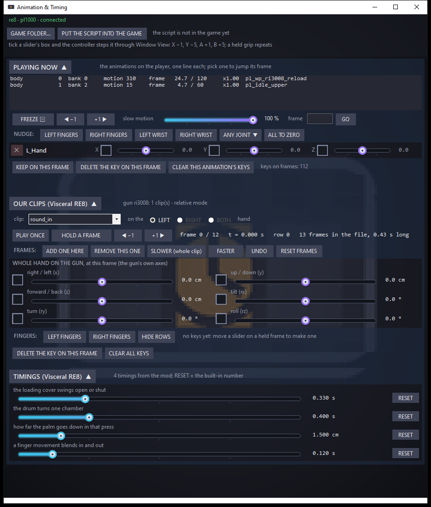

# Animation & Timing — freeze, step and nudge the player's animations; tune a mod's clips and timings

> 🔧 **Built, not yet tried on a real game (2026-11-07).** Everything here was checked against a stand-in game
> (`test\fake_game.py`) and the self-test; the first run against Resident Evil Village with Visceral RE8 is still to
> come. Removing the script's file from the game's `reframework\autorun` folder undoes everything the script does; the
> mod's edit and timing files are plain text in its data folder and can be deleted.

A small desktop window plus one REFramework script, in the family of [Hand Poser](https://github.com/TefMeister/hand-poser-vr).
Hand Poser holds a joint still; this one works on *motion*: the game's own animations as they play on the player, and
the finger movements and timings of our Visceral RE8 mod. It was made for one job first: the left hand that turns the
Wolfsbane's drum sat *through* the drum during the turn, and no slider that holds a pose can fix a hand that is moving.

Three boxes, each folding away:

- **PLAYING NOW**: every animation layer on the player (bank, motion, frame of end, speed, name). **FREEZE** stops the
  animation where it is; **◀ −1** / **+1 ▶** step it one frame; the **slow motion** slider runs it at 5 to 100 %; type a
  frame and **GO** jumps the chosen layer there. **NUDGE** rows (LEFT FINGERS, RIGHT FINGERS, a wrist, or any joint by
  name) turn a joint *on top of* whatever the animation does, live. **KEEP ON THIS FRAME** saves the rows' turns as a key
  on the layer's current frame; the script plays keys back by itself, fading between keyed frames, so a few keys shape a
  whole movement. Keys live in the game's `reframework\data\anim_timing\nudges\<game>\` as one file per animation.
- **OUR CLIPS** (only with Visceral RE8): the mod's finger movements on the docked hands, one per gun event (a round
  going in, the drum turning...). Pick one, **PLAY ONCE** on the hand, or **HOLD A FRAME** and step through it. Frame
  edits never touch the recorded movement: **ADD ONE HERE** holds a frame longer, **REMOVE THIS ONE**, **SLOWER** and
  **FASTER** retime the whole clip, **UNDO**, **RESET FRAMES**. The six **WHOLE HAND** sliders move and turn the hand on
  the gun at this frame (centimetres and degrees in the gun's own axes); **FINGERS** rows turn the clip's joints. Any
  slider moved on a held frame becomes a key on that frame; the mod fades between keys and the hand moves as you drag.
  Tick **COPY ON +1** and each **+1 ▶** carries this frame's pose (whole hand and fingers) onto the next frame as its
  key, so you can walk forward and only fix what changes; **COPY ON −1** does the same walking back with **◀ −1**. Both
  can be on. Only those two buttons copy, one frame at a time, and a frame that already has its own key is left as it was.
- **TIMINGS** (only with Visceral RE8): the mod's named seconds, one slider each with its meaning in words (the cover
  swing, the drum turn, the hammer press, the case slide...). A change reaches the mod within half a second; **RESET**
  goes back to the built-in number.

Tick the box beside any slider and the controller steps it through Window View (X −1, Y −5, A +1, B +5; a held grip
repeats), so a frame can be tuned from inside the headset.

## Get it

Build it yourself: `build.bat` (only the C# compiler that ships with Windows) then `install.ps1` for a desktop icon.
A zip under Releases follows once it has run on a real game. The game needs
[REFramework](https://github.com/praydog/REFramework); the OUR CLIPS and TIMINGS boxes need
[Visceral RE8](https://github.com/TefMeister/visceral-re8-vr) build b080 or later.

## Use

1. Start the game. Double-click **Animation & Timing**; the top line names the game it found, or press **GAME FOLDER...**.
2. Press **PUT THE SCRIPT INTO THE GAME** once, then restart the game or **Reset scripts** in REFramework's menu.
3. Load into the game so there is a character. The PLAYING NOW list fills with the animations on the body.
4. For a game animation: FREEZE, step to the frame, add the joints, drag, KEEP ON THIS FRAME; step on, repeat. Close the
   window and the game has its animations back (the keys stay in the files and keep playing).
5. For a Visceral RE8 clip: take the gun in hand, pick the clip, HOLD A FRAME, step to the bad frame, drag the WHOLE
   HAND sliders until the hand sits right, step on; the keys fade into each other. The files sit beside the clip in the
   mod's `reframework\data\visceral_re8\clips\` folder as `<gun>_<event>.edit.json`.

## How it works

- **The window** (`app\`, C#) writes `command.json` into the game's `reframework\data\anim_timing\` folder on every change
  (freeze, speed, a step, a frame to jump to, the live nudges, the joints to read) and reads `state.json` (the game, the
  character, the layers, every joint, the live angles). For Visceral RE8 it reads the mod's `clips_state.json`
  (the gun's clips, their frames and times, what plays) and writes `scrub.json` (hold this frame / play once / let go),
  the per-clip `.edit.json` (frame ops and keys) and `timings.json` (the named seconds), all under the mod's data folder.
- **The script** (`reframework\autorun\anim_timing.lua`) finds the player the way EMV Engine does (`PlayerManager`, RE4,
  RE7 and RE8 fallbacks), lists the motion layers of its meshes, sets each layer's speed to 0 while frozen (or the slow
  speed) and its frame on a step, before the animation advances; nudges are written as a turn on top of the joint's
  animated rotation after the animation has run (`LateUpdateBehavior`, again at `PrepareRendering`), keyed per frame and
  faded between keys. Joints that are not nudged are never touched. Its own section in REFramework's menu shows what it
  does and has Freeze and Let go buttons.
- **The mod's side** lives in Visceral RE8 (`shellclip.cpp`: the edited frame list, the keys, the hold and the scrub;
  `dockpose.cpp`: the whole-hand move applied on the docked hand; `timings.cpp`: the named seconds, re-read when the file
  changes and listed for the window in `timings_known.json`).
- Frame edits are a list of operations on the recorded clip (`remove i`, `hold i n`, `speed from to x`) and keys are
  kept by the clip's *source* row, so a key survives frames being added or removed around it; the window does the same
  maths as the mod (`app\ClipModel.cs`) so it can show the result at once and the self-test can check it with no game.

## Check it without a game

`dist\AnimTiming.exe --selftest build\selftest` runs the maths and the file shapes (prints PASS). `python test\fake_game.py
build\uitest 60` stands in for the script and the mod; start the window with `--game build\uitest\FakeGame` and every
button has something to act on. `test\click.py` presses buttons by caption, `test\grab_window.py` photographs the window.

## Credits

- [praydog](https://github.com/praydog) for REFramework, which the script runs on.
- [alphaZomega](https://github.com/alphazolam) for EMV Engine, whose player lookup, motion layer reading and pose timing
  this follows.
- Made with Claude by Tefa. If you think you should be credited here, open an issue.

Non-commercial. No game files are included.
